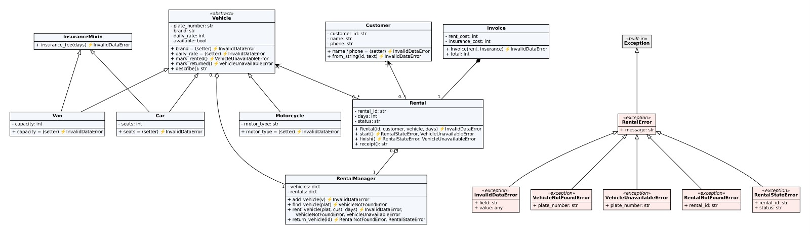

# Rental Kendaraan — Exception Handling

## Identitas

| | |
|---|---|
| **Nama Kelompok** | Kelompok 5 |
| **Judul Studi Kasus** | Sistem Rental Kendaraan |
| **Anggota** | Ni Rai Putri Novianti — 2501010008 <br> Ni Made Devi Sartika Sari — 2501010027 <br> Ni Wayan Citra Aristia Dewi — 2501010029 |

## Deskripsi
Project Rental Kendaraan dikembangkan dari project UTS dengan menambahkan penanganan kesalahan (*exception handling*) menggunakan custom exception. Sistem mengelola data mobil, motor, van, pelanggan, transaksi penyewaan, pengembalian kendaraan, dan invoice.

## Struktur Folder
```text
rental_kendaraan/
├── README.md
├── docs/
│   ├── class-diagram.png     # gambar class diagram (ditampilkan di README ini)
│   └── class-diagram.dot     # sumber diagram (Graphviz)
└── src/
    ├── main.py               # program utama dan pengujian exception handling
    ├── errors.py             # hierarki custom exception
    ├── vehicle.py  car.py  motorcycle.py  van.py
    ├── customer.py  rental.py  rental_manager.py
    └── invoice.py  insurance_mixin.py
```

## Cara Menjalankan
Pastikan Python 3 sudah terpasang. Jalankan dari folder utama project:

```bash
python src/main.py
```

Project hanya memakai modul bawaan Python sehingga tidak memerlukan instalasi library tambahan.

## Aturan Bisnis (Business Rules)

| No | Aturan Bisnis | Class / Method yang Menegakkan | Exception yang Dimunculkan |
|---|---|---|---|
| 1 | Plat nomor harus valid (format `DK 1234 AB`) dan unik | `Vehicle.__init__`, `RentalManager.add_vehicle` | `InvalidDataError` |
| 2 | Merek tidak boleh kosong, harga sewa harian bilangan bulat positif, jenis motor tidak boleh kosong | setter `Vehicle.brand`, `Vehicle.daily_rate`, `Motorcycle.motor_type` | `InvalidDataError` |
| 3 | Nama pelanggan tidak boleh kosong, nomor telepon 10–13 digit angka, format `Nama;NomorTelepon` benar | setter `Customer.name`, `Customer.phone`, `Customer.from_string` | `InvalidDataError` |
| 4 | Jumlah kursi mobil dan kapasitas van harus bilangan bulat > 0 | setter `Car.seats`, `Van.capacity` | `InvalidDataError` |
| 5 | Lama sewa minimal 1 hari | `Rental.__init__`, `InsuranceMixin.insurance_fee` | `InvalidDataError` |
| 6 | Kendaraan hanya dapat disewa jika terdaftar dan sedang tersedia | `RentalManager.find_vehicle`, `Vehicle.mark_rented` (dipanggil `Rental.start`) | `VehicleNotFoundError`, `VehicleUnavailableError` |
| 7 | Kendaraan hanya dapat dikembalikan jika sedang disewa; transaksi selesai tidak bisa dikembalikan dua kali | `RentalManager.return_vehicle`, `Rental.finish`, `Vehicle.mark_returned` | `RentalNotFoundError`, `RentalStateError`, `VehicleUnavailableError` |

## Daftar Custom Exception

Semua exception memiliki `__init__` yang menyimpan atribut konteks lalu memanggil `super().__init__(pesan)`.

| Nama | Induk | Atribut Konteks | Kapan Muncul | Method yang Memunculkan | Cara Menangani |
|---|---|---|---|---|---|
| `RentalError` | `Exception` | `message` | Base class; tidak dimunculkan langsung | — | `except RentalError` menangkap semua kesalahan rental (dipakai sebagai penangkap paling umum) |
| `InvalidDataError` | `RentalError` | `field`, `value` | Data masukan tidak valid (kosong, salah tipe/format, di luar rentang, duplikat) | setter & constructor di `Vehicle`, `Car`, `Van`, `Motorcycle`, `Customer`, `Invoice`, `Rental`; `InsuranceMixin.insurance_fee`; `RentalManager.add_vehicle`, `rent_vehicle` | Tampilkan pesan, minta pengguna memperbaiki input; `error.field` dan `error.value` menunjukkan data yang salah |
| `VehicleNotFoundError` | `RentalError` | `plate_number` | Plat nomor tidak terdaftar | `RentalManager.find_vehicle` (dipakai `rent_vehicle`) | Beri tahu plat tidak ada (`error.plate_number`), minta plat lain |
| `VehicleUnavailableError` | `RentalError` | `plate_number` | Kendaraan sedang disewa saat akan disewa, atau tidak sedang disewa saat akan dikembalikan | `Vehicle.mark_rented`, `Vehicle.mark_returned` | Tolak transaksi, tawarkan kendaraan lain |
| `RentalNotFoundError` | `RentalError` | `rental_id` | ID transaksi tidak ditemukan saat pengembalian | `RentalManager.__find_rental` (dipakai `return_vehicle`) | Minta pengguna memeriksa kembali ID rental |
| `RentalStateError` | `RentalError` | `rental_id`, `status` | Operasi tidak sesuai status transaksi (mis. dikembalikan dua kali) | `Rental.start`, `Rental.finish` | Tolak operasi dan tampilkan status saat ini (`error.status`) |

```text
Exception
└── RentalError
    ├── InvalidDataError
    ├── VehicleNotFoundError
    ├── VehicleUnavailableError
    ├── RentalNotFoundError
    └── RentalStateError
```

## Penerapan Exception Handling
- **`raise`** digunakan pada setter dan method domain saat validasi gagal atau aturan bisnis dilanggar. Class domain tidak memakai `print` untuk error.
- **`try` / `except`** membungkus pemanggilan di `main.py`. Tidak ada `except` kosong; selalu menyebut jenis exception.
- **`except` bertingkat** (`main.py`, fungsi `coba_sewa`): urutan dari paling spesifik (`VehicleNotFoundError`, `VehicleUnavailableError`, `InvalidDataError`) ke paling umum (`RentalError`).
- **`raise ... from`**: `parse_days` di `main.py` mengubah `ValueError` bawaan menjadi `InvalidDataError`; `find_vehicle` dan `__find_rental` mengubah `KeyError` menjadi `VehicleNotFoundError` / `RentalNotFoundError`. Penyebab asli tersimpan di `error.__cause__`.
- **Re-raise** (`raise` tanpa argumen): `sewa_dengan_log` mencatat error lalu melemparnya kembali ke pemanggil.
- **EAFP**: `RentalManager.find_vehicle` langsung mengakses dict dan menangani `KeyError`, bukan mengecek satu per satu dengan loop. Bagian 8d di `main.py` juga langsung memanggil `mark_rented()` tanpa mengecek `is_available` terlebih dahulu.
- **`else`** dijalankan jika blok `try` berhasil; **`finally`** selalu dijalankan, ada error maupun tidak.

## Class Diagram



Kotak merah bertanda `«exception»` adalah hierarki custom exception beserta atribut kontekstualnya. Pada kotak class domain, tanda ⚡ menunjukkan exception yang dimunculkan oleh method tersebut.

## Contoh Output

Hasil `python src/main.py`:

```text
===== 1. MEMBUAT OBJEK =====
Jumlah kendaraan dibuat : 4
Pelanggan 1             : P001 - Budi Santoso (081234567890)
Pelanggan 2             : P002 - Siti Aminah (082345678901)
Informasi kendaraan     : Car(plate_number='DK 1234 AB', brand='Toyota Avanza')

========== DAFTAR KENDARAAN ==========
1. Mobil Toyota Avanza | Plat: DK 1234 AB | Kursi: 7 orang
   Harga: Rp350.000/hari | Status: Tersedia
2. Mobil Honda Brio | Plat: DK 2345 CD | Kursi: 5 orang
   Harga: Rp300.000/hari | Status: Tersedia
3. Motor Honda Scoopy | Plat: DK 5678 EF | Jenis: Matic
   Harga: Rp100.000/hari | Status: Tersedia
4. Van Toyota HiAce | Plat: DK 9876 IJ | Kapasitas: 15 orang
   Harga: Rp800.000/hari | Status: Tersedia
======================================

===== 2. PROSES PENYEWAAN =====
========== STRUK RENTAL ==========
ID Rental    : R001
Pelanggan    : Budi Santoso
Kendaraan    : Toyota Avanza (DK 1234 AB)
Lama Sewa    : 3 hari
Biaya Sewa   : Rp1.050.000
Asuransi     : Rp52.500
Total Biaya  : Rp1.102.500
Status       : Aktif
==================================
Penyewaan pertama berhasil dibuat.
========== STRUK RENTAL ==========
ID Rental    : R002
Pelanggan    : Siti Aminah
Kendaraan    : Honda Scoopy (DK 5678 EF)
Lama Sewa    : 2 hari
Biaya Sewa   : Rp200.000
Asuransi     : Rp0
Total Biaya  : Rp200.000
Status       : Aktif
==================================
Penyewaan kedua berhasil dibuat.
Proses penyewaan selesai diperiksa.

===== 3. PENGUJIAN DATA TIDAK VALID =====
Data harga ditolak: Harga sewa harus bilangan bulat positif, bukan -5000.
Validasi harga selesai.
Nomor telepon ditolak: Nomor telepon tidak valid: 'abc' (harus 10-13 digit angka).
Jumlah kursi ditolak: Jumlah kursi harus bilangan bulat lebih dari 0, bukan 0.
Harga Avanza tetap      : Rp350.000

===== 4. PERBANDINGAN OBJEK DENGAN == =====
avanza == avanza_copy   : True
avanza == brio          : False
Jumlah kendaraan dibuat : 5

===== 5. PENGUJIAN ATURAN BISNIS =====
Penyewaan ditolak: Toyota Avanza (DK 1234 AB) sedang disewa.
Pemeriksaan ketersediaan kendaraan selesai.
Pencarian kendaraan gagal: Kendaraan dengan plat DK 0000 ZZ tidak ditemukan.
Lama sewa ditolak: Lama sewa harus bilangan bulat lebih dari 0 hari.

===== 6. PENGEMBALIAN =====
Setelah dikembalikan: [R001] Budi Santoso - Toyota Avanza (Selesai)
Proses pengembalian selesai.
Pengembalian ulang ditolak: Rental R001 sudah selesai dan tidak dapat dikembalikan lagi.

========== DAFTAR KENDARAAN ==========
1. Mobil Toyota Avanza | Plat: DK 1234 AB | Kursi: 7 orang
   Harga: Rp350.000/hari | Status: Tersedia
2. Mobil Honda Brio | Plat: DK 2345 CD | Kursi: 5 orang
   Harga: Rp300.000/hari | Status: Tersedia
3. Motor Honda Scoopy | Plat: DK 5678 EF | Jenis: Matic
   Harga: Rp100.000/hari | Status: Disewa
4. Van Toyota HiAce | Plat: DK 9876 IJ | Kapasitas: 15 orang
   Harga: Rp800.000/hari | Status: Tersedia
======================================

========== DAFTAR TRANSAKSI ==========
[R001] Budi Santoso - Toyota Avanza (Selesai) | Total: Rp1.102.500
[R002] Siti Aminah - Honda Scoopy (Aktif) | Total: Rp200.000
======================================

===== 7. METHOD RESOLUTION ORDER (MRO) =====
MRO Car        : Car -> InsuranceMixin -> Vehicle -> ABC -> object
MRO Motorcycle : Motorcycle -> Vehicle -> ABC -> object
Asuransi Avanza 3 hari  : Rp52.500

===== 8. EXCEPT BERTINGKAT, RAISE FROM, RE-RAISE, EAFP =====
--- 8a. except bertingkat (spesifik -> umum) ---
[spesifik] Plat DK 0000 ZZ tidak ada di sistem.
[finally] Pemeriksaan sewa DK 0000 ZZ selesai.
[spesifik] Kendaraan DK 5678 EF sedang tidak tersedia.
[finally] Pemeriksaan sewa DK 5678 EF selesai.
[spesifik] Data 'days' ditolak (nilai: -2).
[finally] Pemeriksaan sewa DK 9876 IJ selesai.
[berhasil] [R003] Budi Santoso - Toyota HiAce (Aktif)
[finally] Pemeriksaan sewa DK 9876 IJ selesai.
--- 8b. raise ... from ---
Ditolak: Lama sewa harus berupa angka, bukan 'tiga'.
Penyebab asli (__cause__): ValueError("invalid literal for int() with base 10: 'tiga'")
--- 8c. re-raise dengan `raise` ---
[LOG] Gagal menyewa DK 5678 EF: VehicleUnavailableError
Ditangani di level atas: Honda Scoopy (DK 5678 EF) sedang disewa.
--- 8d. Gaya EAFP ---
Percobaan 1: Honda Brio berhasil ditandai disewa.
Percobaan 2: gagal - Honda Brio (DK 2345 CD) sedang disewa.
```

## Pembagian Peran

| [Ni Rai Putri Novianti] | [2501010008] | [ car.py, motorcycle.py, van.py, customer.py,  errors.py,] |
| [Ni Made Devi Sartika Sari] | [2501010027] | [ rental.py, rental_manager.py, main.py,invoice.py ] |
| [Ni Wayan Citra Aristia Dewi] | [2501010029] | [README.md, vehicle.py, insurance_mixin.py, docs/class-diagram.png] |